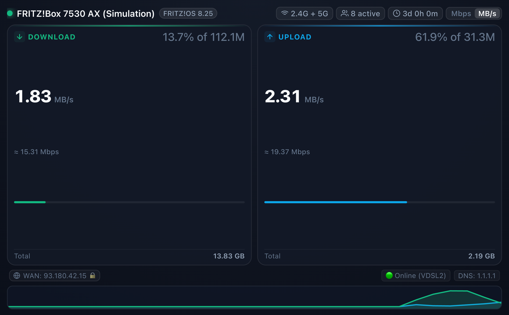
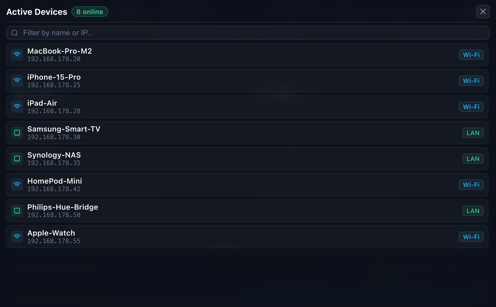

# FRITZ!Box Homarr Widget (FRITZ!OS 8.25+)

A stateless, ultra-lightweight real-time web widget and backend to monitor your AVM FRITZ!Box router directly from your [Homarr](https://homarr.dev/) dashboard via an embedded iFrame tile.

Designed specifically for **FRITZ!OS 8.25** (and compatible with FRITZ!OS 7.50+), strictly adhering to AVM's TR-064 SOAP specifications with HTTP Digest Authentication (RFC 2617).


---

## Screenshots

<div align="center">
  
</div>

<div align="center">
  
  <p><em>Real-time traffic throughput, line utilization, active devices counter, and 60-second sparkline activity chart.</em></p>
</div>

---

## Features

- **Real-Time Traffic Monitoring**: Queries `urn:dslforum-org:service:WANCommonInterfaceConfig:1` (`GetAddonInfos`) to extract `NewByteReceiveRate` and `NewByteSendRate`, computing live download and upload throughput.
- **Dual Display & Unit Switcher**: Easily switch between **Mbps** (Megabits/s) and **MB/s** (Megabytes/s) via a 1-click toggle, with dual conversions displayed side-by-side.
- **Internet Plan Line Utilization**: Extracts maximum sync bandwidth (`GetCommonLinkProperties`) and shows a live utilization bar with % of your line capacity.
- **Actively Connected Devices & Client Modal**: Real-time badge tracking online active clients (filtering out stale/historical DHCP leases). Click the badge to open an interactive dark-mode popup listing all online devices with hostnames, IP addresses, connection type badges (Wi-Fi 📶 vs LAN 🔌), and instant search filter.
- **External Public IP with Privacy Toggle**: Auto-discovers public WAN IP across DSL/PPPoE, Fiber, and Cable connections with a 1-click privacy mask toggle (👁) to keep IP addresses safe from accidental exposure in screenshots.
- **Wi-Fi Bands & DNS Status**: Real-time indicators showing active broadcasting bands (2.4G + 5G) and primary upstream DNS servers.
- **Accurate Uptime Tracking**: Queries `urn:dslforum-org:service:DeviceInfo:1` (`GetInfo`) to extract `NewUpTime` and cleanly formats it into days, hours, and minutes.
- **Non-blocking & DoS-Protected**: Slower-changing metadata and active host enumeration refresh asynchronously in background worker threads with an in-memory cache layer (`1.5s` traffic, `20s` metadata) to protect router CPU from query exhaustion.
- **FRITZ!OS 8.25 Compatibility**: Handled via `fritzconnection` with full TR-064 challenge-response authentication, nonces, and session reuse.
- **Homarr Dark Mode Native**: Modern slate dark-theme UI with responsive flex layout, subtle glowing accents, and zero scrollbars for iFrame embedding.
- **Embedded Sparkline Graph**: Real-time traffic activity canvas (last 60 seconds) with pure vanilla JS (0 external frontend dependencies).
- **Ultra-lightweight Container**: Built on Alpine Linux (`python:3.12-alpine`) with production Gunicorn WSGI server. Image size is **under 75MB**.
- **Safe Public Repo Setup**: Pre-configured `.gitignore` prevents accidental leaking of router credentials. Template provided in `.env.example`.

---

## Architecture & Endpoints

```
┌────────────────────────┐         SOAP / HTTP Digest Auth         ┌─────────────────────────┐
│                        │────────────────────────────────────────▶│                         │
│  FRITZ!Box Widget      │  GetAddonInfos (Byte Rates, Totals)     │  AVM FRITZ!Box          │
│  (Flask + Gunicorn)    │  GetInfo (Uptime, Firmware, Model)      │  (FRITZ!OS 8.25)        │
│                        │◀────────────────────────────────────────│  Port 49000 / 49443     │
└────────────────────────┘                                         └─────────────────────────┘
         ▲
         │ Polling every 2s (JSON)
         │
┌────────────────────────┐
│  Homarr Dashboard      │
│  (Embedded iFrame)     │
└────────────────────────┘
```

- `GET /` — Dark-mode responsive widget frontend for Homarr.
- `GET /api/metrics` — JSON endpoint returning live bandwidth (Mbps, Kbps, bytes/sec), uptime, and router status.
- `GET /health` — Lightweight health-check endpoint for container orchestration.

---

## 1. FRITZ!Box Preparation (FRITZ!OS 8.25+)

FRITZ!OS 8.25 strictly requires an authenticated user account with TR-064 permissions:

1. **Allow TR-064 Application Access**:
   - Open your router interface (default `http://192.168.178.1` or `http://fritz.box`).
   - Navigate to: **Home Network (*Heimnetz*)** → **Network (*Netzwerk*)** → **Network Settings (*Netzwerkeinstellungen*)**.
   - Under *LAN Settings*, enable the checkbox: **"Allow access for applications" (*Zugriff für Anwendungen zulassen*)**.
   - Click **Apply (*Übernehmen*)**.

2. **Create a Dedicated User Account**:
   - Navigate to: **System** → **FRITZ!Box Users (*FRITZ!Box-Benutzer*)**.
   - Click **Add User (*Benutzer hinzufügen*)**.
   - Set a username (e.g., `homarr-monitor`) and a secure password.
   - Under *Permissions (*Berechtigungen*)*, check **FRITZ!Box Settings (*FRITZ!Box-Einstellungen*)**.
   - Click **Apply (*Übernehmen*)**.

---

## 2. Configuration (`.env`)

Copy the example configuration:
```bash
cp .env.example .env
```

Edit `.env` with your router details:
```env
# Router IP or hostname
ROUTER_IP=192.168.178.1

# TR-064 Port (49000 for HTTP, 49443 for HTTPS)
ROUTER_PORT=49000
ROUTER_PROTOCOL=http

# Router User Credentials (created in step 1)
ROUTER_USERNAME=homarr-monitor
ROUTER_PASSWORD=your_secret_password

# Port where this widget will be served (default: 5050)
PORT=5050

# Set to 'true' if you want simulated metrics for dashboard preview without router access
MOCK_MODE=false
```

> [!IMPORTANT]
> The `.env` file is listed in `.gitignore` and will never be committed to your Git repository.

---

## 3. Running with Docker

### Option A: Docker Compose (Recommended)
```bash
docker compose up -d
```

### Option B: Docker CLI
```bash
# Build the minimal image (~75MB)
docker build -t fritzbox-homarr-widget .

# Run the container
docker run -d \
  --name fritzbox-homarr-widget \
  --restart unless-stopped \
  -p 5050:5050 \
  --env-file .env \
  fritzbox-homarr-widget
```

Verify it is running:
```bash
curl http://localhost:5050/api/metrics
```

---

## 4. Adding to Homarr Dashboard

1. Open your **Homarr** dashboard.
2. Enter **Edit Mode** (pencil icon in the top right).
3. Click **Add Tile** and choose **iFrame / Embed**.
4. Configure the widget tile:
   - **URL**: `http://<YOUR_DOCKER_HOST_IP>:5050` (e.g. `http://192.168.1.100:5050`)
   - **Title**: *FRITZ!Box* (or leave blank for clean borderless look)
   - **Width**: `2` or `3` grid units
   - **Height**: `1` or `2` grid units
5. Save changes. The widget will seamlessly blend into Homarr's dark theme with zero scrollbars.

---

## API Response Example (`/api/metrics`)

```json
{
  "status": "online",
  "router": {
    "ip": "192.168.178.1",
    "model": "FRITZ!Box 7530 AX",
    "firmware": "FRITZ!OS 8.25",
    "software_version": "256.08.25",
    "access_type": "DSL",
    "connected_devices": 14
  },
  "traffic": {
    "download": {
      "mbps": 82.45,
      "mbyte_s": 10.31,
      "kbps": 82450.0,
      "bytes_per_sec": 10306250,
      "max_mbps": 100.0,
      "utilization_pct": 82.5,
      "formatted_mbps": "82.45 Mbps",
      "formatted_mbytes": "10.31 MB/s",
      "total_bytes": 48234928120,
      "total_formatted": "44.92 GB"
    },
    "upload": {
      "mbps": 19.32,
      "mbyte_s": 2.42,
      "kbps": 19320.0,
      "bytes_per_sec": 2415000,
      "max_mbps": 40.0,
      "utilization_pct": 48.3,
      "formatted_mbps": "19.32 Mbps",
      "formatted_mbytes": "2.42 MB/s",
      "total_bytes": 5839201948,
      "total_formatted": "5.44 GB"
    }
  },
  "uptime": {
    "total_seconds": 328400,
    "days": 3,
    "hours": 19,
    "minutes": 13,
    "seconds": 20,
    "formatted": "3d 19h 13m"
  },
  "timestamp": "2026-10-22T20:25:30.123456+00:00",
  "mock_mode": false
}
```

---

## Troubleshooting

- **HTTP ERROR 403 on `localhost:5000` (macOS AirPlay conflict)**:
  - macOS Monterey, Ventura, Sonoma, and Sequoia bind port `5000` to Apple's **AirPlay Receiver** (`ControlCenter`) by default.
  - This widget defaults to port **`5050`** to avoid this issue. If you specifically need port `5000`, disable AirPlay Receiver in **System Settings → General → AirDrop & AirPlay → AirPlay Receiver (toggle off)**.
- **HTTP 401 Unauthorized**:
  - Verify that the user exists in **System → FRITZ!Box Users**.
  - Ensure **"Allow access for applications"** is checked in **Home Network → Network → Network Settings**.
  - Modern FRITZ!OS versions do not accept empty usernames.
- **Connection Refused / Timeout**:
  - Ensure the Docker host has network connectivity to the FRITZ!Box IP (usually `192.168.178.1`).
  - If running in Docker across subnets, verify TR-064 port `49000` is routable.
- **Testing the UI without router connection**:
  - Set `MOCK_MODE=true` in `.env` to test layout, canvas charts, and responsiveness.
